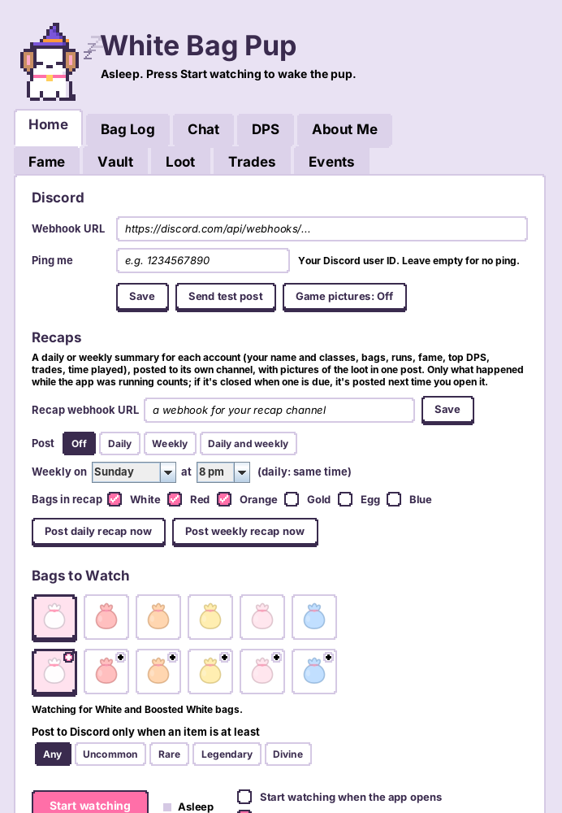
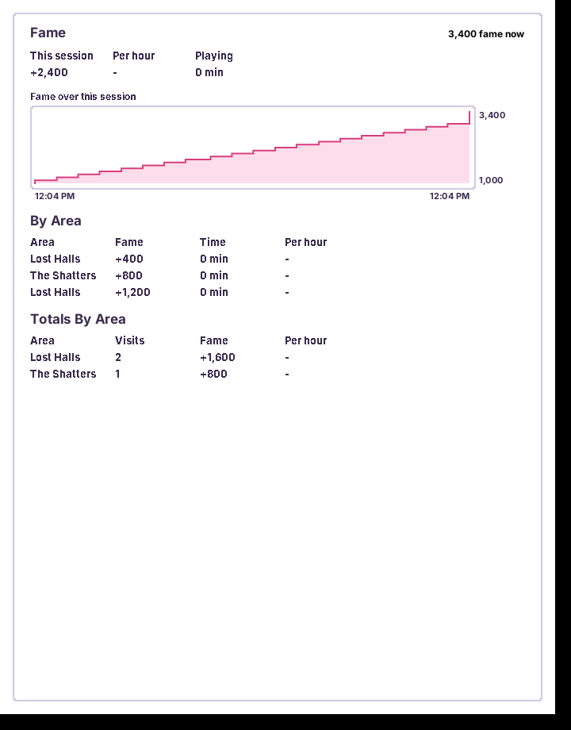
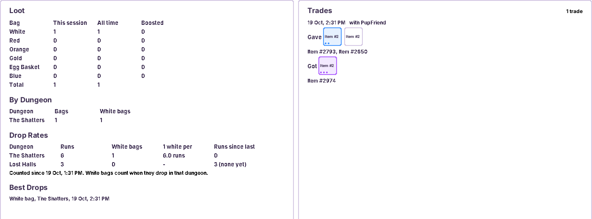

# White Bag Pup 🐶

A little desktop companion for **Realm of the Mad God**. It barks in your Discord when a white bag drops, and keeps
an eye on your DPS, fame, loot, trades and realm events while you play.

It only **reads** the game's network traffic (the same way RealmShark/Tomato does). It never touches the game client,
never sends anything to the game, and never plays for you.

## Download

Get **WhiteBagPup.jar** from the [latest release](../../releases/latest).

From 2.6 on, the pup updates itself: when a new version is out, it downloads it in the background (after backing up
your files) and installs it when you close the pup, so it opens on the new version next time. Press the pink button
at the top of Home to restart onto it straight away. The old version is kept as `WhiteBagPup.jar.old`. Untick
**Install updates by itself** on Home if you'd rather update by hand.
Download the new jar and put it in the same folder in place of the old one. Your settings and logs stay.
See [CHANGELOG.md](CHANGELOG.md) for what changed in each version.

## Setup (Windows)

1. Install **Java** (https://www.java.com/download) and **Npcap** (https://npcap.com/#download).
   If you already use Tomato or RealmShark, you have both.
2. Make a folder somewhere plain, like `C:\WhiteBagPup` (not inside a zip, OneDrive, Program Files or a protected
   Desktop folder), and put `WhiteBagPup.jar` in it. The app saves its settings and logs next to itself.
3. Make a Discord webhook: in your server, **Server Settings > Integrations > Webhooks > New Webhook**, pick the
   channel, then **Copy Webhook URL**.
4. Double-click `WhiteBagPup.jar`, open the **Webhooks** tab, paste the URL under **Bag posts** and press
   **Send test post**.
5. Optional: to get pinged, turn on **Discord Settings > Advanced > Developer Mode**, right-click your name,
   **Copy User ID**, and paste it into **Ping me**.
6. Press **Start watching**. If you're already in game, change area once (go to the Nexus) so it can sync.

The first time, it reads item names and pictures from your game install. That can take a minute and happens again
whenever the game updates. If your game is installed somewhere unusual, run
`java -jar WhiteBagPup.jar --path "C:\path\to\resources.assets"`.

### Friends leaderboard (optional)

If your recap link is a Femcore bot link (`https://.../recap?key=...`), tick **Join the friends leaderboard** under
Recaps on the Webhooks tab. Every few minutes the pup sends your in-game name and totals (white bags, bags, runs,
kills, fame, play time, badge and collection counts) to the bot, which keeps a live leaderboard in Discord.
Nothing else is sent.

### Backups

The **Backups** section on Home zips your logs, badges, settings and sounds into the `backups` folder: press
**Back up now**, or leave **Back up every week by itself** on. The last 8 are kept. **Restore...** puts one back
(what's there now is backed up first) and closes the pup so it opens fresh. The pup also backs up before updating.

### Badge posts (optional)

New badges post to your bag webhook. To send them somewhere else, make another webhook and paste it under
**Badges** on the Webhooks tab. **Send test post** shows what one looks like.

### Recaps (optional)

1. Make a second webhook for the channel the recaps should go to (the same way as step 3).
2. On the **Webhooks** tab under **Recaps**, paste it into **Recap webhook URL** and press **Save**.
3. Pick **Daily**, **Weekly** or **Daily and weekly**, and the day and time to post.
4. Tick the **Bags in recap** you want counted and pictured (White, Red and Orange to start with).
5. Press **Post daily recap now** to see what one looks like.

The recap shows your in-game name and the classes you played. All the loot comes in that one post as pictures:
click one and use the arrows to flip through. With two accounts, each one gets its own recap post. Only time the
app was running counts; if the app is closed when a recap is due, it's posted the next time you open it.

If someone gives you a **bot recap link** (`https://.../recap?key=...`), paste that instead of a webhook. The
recap then comes with ◀ ▶ buttons under the loot picture.

For the posts' profile picture, upload [`images/white-bag-pup-avatar.png`](images/white-bag-pup-avatar.png)
in your webhook's settings.

## What it does

The tabs are **Home**, **Loot** (Bag Log, Stats, Collection), **Fights** (DPS, Boss Kills), **Me** (About Me, Fame,
Vault, Badges), **Chat** (Chat, Trades), **Events** and **Puzzle**.

- **Bag posts**: the bag, every item with its tier (UT, ST, T12...) and rarity (Uncommon to Divine), the dungeon,
  your character and the time. Pick which bag colours to watch, and only post bags with an item of a certain rarity (or only bags with a shiny).
  Optionally add a picture of your game window (**Game pictures: On**); only the game itself is pictured,
  never other windows in front of it. Overflow bags are merged into one post.
- **Bag Log**: every bag it barked about this session.
- **Chat**: all in-game chat, colour-coded, with filters and search.
- **DPS**: a leaderboard for each boss in each run, with damage taken and Oryx 3 guarded hits.
- **Boss Kills**: every boss you've helped kill, per boss, with your best % of the damage and fastest kill.
- **About Me**: your character, play time, an exalt tracker for every class, and stats (with max and exaltations), gear with enchantments, your pet with a
  feeding planner, and the Tinkerer's quests (click to cross things off).
- **Fame**: fame this session, per hour, a chart, and fame by dungeon.
- **Vault**: your vault, potion storage and gift chest, with stat potion counts.
- **Loot**: every bag seen (all colours), by dungeon, dry streaks ("23 Shatters runs since your last white"),
  drop rates ("1 white per 12 Shatters runs") and best drops.
- **Collection**: every UT and ST item that can drop (and every shiny version), by dungeon, greyed out until you've
  looted it. Share it on Discord,
  and bag posts say when an item is new to your collection.
- **Dungeons**: every dungeon side by side, with its difficulty, what drops the portal and the UT/ST items there. Hover over an item to see if it's in your collection.
- **Wardrobe** (under Me): hats and outfits for the pup, unlocked by badges.
- **Badges**: pup achievements that unlock as you play, announced on Discord.
- **Puzzle**: a solver for The Shatters' Puzzle Room: the towers to shoot to turn them all green.
- **Trades**: every trade you finish, who with, and what you gave and got.
- **Events**: realm events, dungeon key pops and closing realms on every server from RealmStock's event notifier,
  with tick boxes for what you care about, a search box, a region filter and a sound you can turn off.
- **Recaps**: a daily and/or weekly summary for each account posted to its own Discord channel: your name and
  classes, bags, runs, luckiest dungeon, fame and time played, with all the loot as pictures you
  flip through with arrows. Set it up under **Recaps** on the Webhooks tab.
- **Two accounts at once**: each game client gets its own tabs; switch with the Account buttons.

## Sounds

Each bag has its own built-in squeak. To turn one off, untick the Sound box under that bag in Bags to Watch.

Put `.wav` files in the `sounds` folder next to the app (MP3 doesn't work, convert it first):

- Bags: `white.wav`, `red.wav`, `orange.wav`, `gold.wav`, `egg.wav`, `blue.wav`, `cyan.wav` (and `boosted-white.wav` and so on).
- Events: `event.wav`, `key-pop.wav`, `realm-closed.wav`, or one named after a single event, like `cube-god.wav`.

## Files it saves

Everything stays in the app's folder on your PC:

| File | What's in it |
| --- | --- |
| `titles-debug.txt` | What the pup found for your title in the game files (send it over if your title shows wrong) |
| `whitebag-notifier.properties` | Your settings and webhook URLs (keep this private) |
| `events.properties` | Your Events tick boxes |
| `loot-log.txt`, `runs-log.txt` | Bags seen and dungeons run (for Loot and drop rates) |
| `fame-log.txt`, `dps-log.txt` | Fame and DPS history (for recaps) |
| `trade-log.txt` | Your trades |
| `play-log.txt` | Your time in game (for About Me and recaps) |
| `boss-filter.txt` | Bosses you've hidden on the Boss Kills tab |
| `puzzle-debug.txt` | What the pup noticed about Shatters puzzle towers (only if it saw any) |
| `badges.txt`, `badge-events.txt` | Your unlocked badges |
| `exalt-log.txt` | Your classes' exaltation progress over time (for the exalt tracker) |
| `names.txt` | Each account's in-game name (for recaps) |
| `assets/` | Item names and pictures read from the game |
| `sounds/` | Your custom sounds |
| `puppy.properties`, `vault*.txt`, `pet-cache.txt` | Small caches the app keeps for itself |

To move to a new PC, copy the whole folder. To start fresh, delete the log files.

## Good to know

- **Keep your webhook URL private.** It's saved in `whitebag-notifier.properties`, which only lives on your PC.
- **"Extraction access denied"** means Windows blocked the app from saving the game files. Move the folder somewhere
  plain like `C:\WhiteBagPup`, or allow Java under **Windows Security > Ransomware protection > Controlled folder access**.
- **Don't run other packet sniffers at the same time** if you see sniffer errors.
- Use it at your own risk. It's an unofficial fan tool and isn't affiliated with DECA.

## Building from source

`build.sh` compiles the packet library, its dependencies (pcap 1.4.2, JNA 5.12.1, Gson 2.9.1, FlatBuffers 23.5.26)
and the app into one Java 8 jar. It expects these checkouts next to this folder: `../RealmShark` (or `../Puppy`) and
`../dl/{pcap,gson,fb,jna}`. The files in `src/main/java/packets` and `src/main/java/assets` replace the library's own
copies.

To publish a new version: bump `VERSION` in `src/main/java/whitebag/UpdateCheck.java` (1.0, 1.1, 1.2...), build,
then on GitHub **Releases > Draft a new release**, use the same number as the tag, attach `WhiteBagPup.jar`
and publish. Add the new version to the top of `CHANGELOG.md` too.

## Credits and licences

- The packet library is based on [RealmShark](https://github.com/X-com/RealmShark) by X-com (MIT licence).
- The item rarity (enchantment) format follows [DaAwesomePwner's RealmShark fork](https://github.com/DaAwesomePwner/RealmShark) (MIT).
- Where each UT and ST item drops (the Collection tab) comes from the [RealmEye wiki](https://www.realmeye.com/wiki).
  `tools/build_collection.py` rebuilds the list from the Femcore bot's `ut_items.json`.
- The all-servers event feed comes from [RealmStock's event notifier](https://realmstock.com/pages/event-notifier).
- The font is [Nunito](https://github.com/googlefonts/nunito) (SIL Open Font License 1.1).
- pcap (MIT/Apache-2.0), JNA (Apache-2.0/LGPL), Gson and FlatBuffers (Apache-2.0).

Their licence texts are in the [`licenses`](licenses) folder and inside the jar.
Game assets © DECA Live Operations GmbH.
